# Academic Planning Engine

A constraint-based academic planning platform that reconciles a transcript against
a governing curriculum, evaluates registration eligibility, prevents timetable
conflicts, and produces a multi-term graduation plan with Google OR-Tools CP-SAT.

The project is designed as a portfolio-grade reference implementation of a
rules-heavy planning system. It combines a typed domain model, auditable policy
decisions, transactional imports, database migrations, a REST API, and a local web
interface. All committed demonstrations and tests use synthetic data.

> **Important:** This is decision-support software, not an official degree audit or
> academic-advising service. Results depend entirely on the supplied catalog,
> equivalencies, offerings, approvals, and policy configuration.

## What it demonstrates

- A layered Python architecture with domain, persistence, policy, optimization,
  orchestration, and presentation boundaries.
- Sequential lexicographic optimization, where high-priority academic objectives
  cannot be traded away for lower-priority convenience preferences.
- OLD-to-NEW curriculum transition handling without changing a student's governing
  graduation contract.
- Transcript normalization, repeated-attempt handling, equivalency recognition,
  prerequisites, training periods, capstone pathways, and ECTS capacity policies.
- Exact current-term section bundles and interval-based timetable conflict checks.
- Preview-before-commit imports with validation reports and transactional catalog
  replacement.
- Reproducible synthetic database seeding, Alembic migrations, and an isolated
  pytest suite that does not depend on a developer's local database.

## Architecture

```mermaid
flowchart LR
    Input[CSV / XLSX / PDF / pasted record] --> Import[Parsing and validation]
    Import --> DB[(SQLite / SQLAlchemy)]
    DB --> Normalize[Transcript normalization]
    Normalize --> Reconcile[Requirement reconciliation]
    Reconcile --> Eligibility[Eligibility and policy filters]
    Eligibility --> Solver[CP-SAT planning model]
    Solver --> Audit[Plan validation and diagnostics]
    Audit --> API[FastAPI and browser UI]
```



The core rule is that the graduation contract and the registration course pool are
different concepts. A verified replacement may satisfy an older requirement
without silently converting the student to a newer curriculum.

Detailed design references:

- [Architecture](docs/ARCHITECTURE.md)
- [Academic model](docs/ACADEMIC_MODEL.md)
- [Optimizer](docs/OPTIMIZER.md)
- [Development guide](docs/DEVELOPMENT.md)
- [Data contracts](data/README.md)
- [Scheduling engine design](docs/SCHEDULING_ENGINE_DESIGN.md)

## Technology

- Python 3.11+
- FastAPI and Uvicorn
- SQLAlchemy 2 and Alembic
- Pydantic 2
- Google OR-Tools CP-SAT
- openpyxl and pypdf
- pytest and HTTPX
- Vanilla HTML, CSS, and JavaScript

## Quick start

From the repository root in Windows PowerShell:

```powershell
py -m venv .venv
.\.venv\Scripts\python.exe -m pip install -e ".[test]"
Copy-Item .env.example .env
.\.venv\Scripts\python.exe -m alembic upgrade head
# Run the next command only for a new public-demo database.
.\.venv\Scripts\python.exe -m academic_planner.database.seed
.\.venv\Scripts\python.exe -m uvicorn academic_planner.web.app:app --host 127.0.0.1 --port 8000
```

On macOS or Linux, use `.venv/bin/python` and copy the environment file with
`cp .env.example .env`.

Open <http://127.0.0.1:8000>. Useful routes include:

- `/student-input` - paste, review, save, and analyze an academic record;
- `/scenario-lab` - run deterministic synthetic planning scenarios;
- `/courses` - inspect curricula, prerequisites, and equivalencies;
- `/timetable` - inspect active-term offerings and section bundles;
- `/settings` - edit persisted engine settings;
- `/imports` - preview and confirm curriculum imports;
- `/docs` - inspect the generated OpenAPI contract.

The web application is local and unauthenticated. Keep it bound to `127.0.0.1`
unless authentication and authorization are added.

## Reproducible database seed

The public seed is deterministic, idempotent, and contains no student records or
uploaded source documents. It creates synthetic OLD and NEW curricula, requirements,
prerequisites, transition mappings, current-term offerings, and default settings.
Use it only for a new database or a database whose curriculum revision is already
`synthetic-demo`.

For a new public-demo database, run both commands:

```powershell
.\.venv\Scripts\python.exe -m alembic upgrade head
.\.venv\Scripts\python.exe -m academic_planner.database.seed
```

The equivalent installed command is:

```powershell
academic-planner-seed
```

The target database is controlled by `DATABASE_URL` in `.env`. The default is
`sqlite:///./data/planner.db`. The seeder never scans local folders or imports
private documents automatically. It refuses to run when the target already contains
a non-synthetic catalog, preventing demo data from being mixed into an operational
database.

For an operational database containing imported curricula or student records, run
the migration only:

```powershell
.\.venv\Scripts\python.exe -m alembic upgrade head
```

Do **not** run `academic_planner.database.seed` against an operational database. A
`Refusing to mix the public demo seed into a non-synthetic catalog` error means the
safety check worked; the seeder stops before changing data.

After updating an existing public-demo deployment, rerun the seed command. It
repairs catalogs created by older seed versions by applying the graduation-credit
policy after course insertion: synthetic filler rows and known non-degree courses
are not mandatory, while training and final-project courses retain their required
roles.

## Active semester and timetable maintenance

Open `/timetable` to select the active academic year and semester. Switching the
active semester does not delete offerings saved for another term. If the selected
term has no timetable, use **Add first offering** to enter a course, section, and
meeting time manually. Switching back restores the offerings previously saved for
that term.

## Synthetic CLI

The CLI runs entirely from in-code synthetic fixtures:

```powershell
.\.venv\Scripts\python.exe -m academic_planner --list-scenarios
.\.venv\Scripts\python.exe -m academic_planner --scenario fresh
.\.venv\Scripts\python.exe -m academic_planner --scenario failed-fourth --conditional-repeat-load
.\.venv\Scripts\python.exe -m academic_planner --compare-fixtures
.\.venv\Scripts\python.exe -m academic_planner --prospective-equivalency-experiment
```

Use `--debug`, `--debug-course CODE`, or `--log-file PATH` for observational
diagnostics. Diagnostic output does not change solver constraints.

## Parser scope and compatibility

The repository includes parsers because import boundaries and validation are core
parts of the engine. They are format-specific adapters, not universal document
readers.

> **Parser compatibility notice:** The XLSX, PDF, CSV, and pasted-text parsers were
> validated against a limited set of known layouts and synthetic structural
> fixtures. Different column names, page layouts, OCR output, merged cells, line
> wrapping, encodings, or institution-specific conventions may cause a parser to
> reject a file or interpret it incorrectly. Always review the complete preview and
> validation report before confirming an import. Parser output must not be treated
> as authoritative without human verification.

Raw source documents and retained uploads are intentionally excluded from version
control. Tests generate the minimum workbook, PDF, and CSV structures they need at
runtime.

## Testing

Run the complete suite with:

```powershell
.\.venv\Scripts\python.exe -m pytest -q
```

Tests use a temporary SQLite database populated by the public synthetic seeder.
They cover domain validation, imports, normalization, reconciliation, eligibility,
optimization, horizon extension, timetable conflicts, migrations/persistence, and
HTTP APIs.

## Project structure

```text
src/academic_planner/
  database/        SQLAlchemy models, loaders, services, and public seeder
  importing/       XLSX, PDF, CSV, and contract-sheet adapters
  domain/          Typed academic and planning value objects
  transcripts/     Credit identity and transcript normalization
  matching/        Equivalency matching and transition catalog coverage
  reconciliation/  Requirement and earned-credit reconciliation
  eligibility/     Current-term eligibility construction
  policies/        Registration, rollout, and credit policies
  optimization/    CP-SAT model and lexicographic solve lifecycle
  planning/        Planning orchestration and pathway behavior
  diagnostics/     Audits and bounded counterfactual experiments
  student_input/   Preview, review, and persistence workflow
  web/             FastAPI routes and local browser interface
migrations/        Append-only Alembic schema history
tests/             Unit, integration, scenario, parser, and API tests
```

## Known limitations

- Parser compatibility is intentionally narrow and source-layout dependent.
- Future offerings are assumptions unless backed by verified source data.
- The planner does not infer administrative approval from a transcript, catalog
  label, observed registration, or requested credit capacity.
- The local web application has no authentication, multi-user isolation, job queue,
  or server-side PDF renderer.
- An optimal result is optimal only within the supplied horizon, modeled rules, and
  solver time budget.

## Privacy and repository hygiene

- No real student names, identifiers, transcripts, grades, or uploaded documents
  are part of the public source tree.
- Test identities use generic labels and explicitly synthetic identifiers.
- Local databases, retained imports, backups, environment files, and source
  documents are ignored by Git.
- When publishing a fork, audit both the working tree and reachable Git history;
  deleting a sensitive file in a later commit does not remove it from earlier
  commits.

## License

Copyright (c) 2026 Fouad. All rights reserved.

This repository is publicly viewable for evaluation and portfolio purposes only.
No permission is granted to use, copy, modify, distribute, deploy, sublicense, sell,
train on, or create derivative works from it without prior written permission. See
[LICENSE](LICENSE) for the complete terms.

This is a restrictive source-available notice, not an open-source license.
