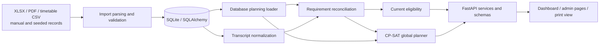
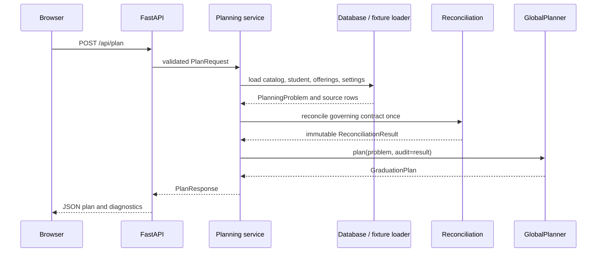

# Architecture

## System shape

The engine is a layered Python application. Domain values are immutable dataclasses;
persistence uses SQLAlchemy; the web boundary uses FastAPI and Pydantic; scheduling
uses one OR-Tools CP-SAT model. The browser is plain HTML, CSS, and JavaScript.

The in-memory synthetic workflow enters at the same reconciliation and planner
layers through `academic_planner.fixtures`; it does not use the database loader.

## Module responsibilities

| Module | Responsibility |
| --- | --- |
| `domain.models` | Curriculum, course, attempt, offering, configuration, and plan value objects. |
| `database.models` | Persisted catalog, transition, offering, student, import, and contract records. |
| `database.session` | Engine/session lifecycle, SQLite foreign keys, and transaction scopes. |
| `database.loader` | Converts active persisted data into a typed `PlanningProblem`. |
| `importing` | Parses OLD XLSX, NEW PDF, contract PDF, and timetable CSV sources; validates and replaces data transactionally. |
| `matching` | Maintains durable OLD-to-NEW coverage and administrator-reviewed equivalency matching. |
| `transcripts` | Normalizes source rows into planning attempts without inventing identities or credit. |
| `reconciliation` | Resolves the governing contract, accepted history, classifications, and official earned credit. |
| `requirement_delivery` | Adds verified prospective substitutes as delivery alternatives while retaining the original requirement. |
| `eligibility` / `policies` | Applies current offering, prerequisite, rollout, track, and capacity rules. |
| `planning` | Runs reconciliation once, applies the registered FYP pathway, and sends the same audit to optimization and presentation. |
| `optimization.planner` | Builds and solves the complete scheduling model. |
| `validation` / `diagnostics` | Checks a returned plan and explains modeled outcomes without changing constraints. |
| `web` | Routes, request validation, orchestration, response serialization, and static UI. |

## Request sequence

For database students, `DatabaseStudentPlanningService` additionally normalizes
transcript rows, verifies complete OLD transition-catalog coverage, applies persisted
capacity decisions, and builds contract category groups. It still uses the shared
`AcademicPlanningEngine`, reconciliation service, and optimizer.

## Academic data flow

Course identity, requirement identity, and accepted credit are kept separate:

- A `Curriculum` holds the governing requirement IDs and accepted-credit target.
- `CourseAttempt` holds historical status and recorded earned ECTS.
- `CourseEquivalency` controls recognized history and, independently, whether a
  cross-curriculum course may be registered prospectively.
- `ReconciliationResult` is the audit boundary: satisfied/outstanding requirements,
  one-to-one allocations, prerequisite completions, official credit, and
  student-specific classifications.
- `PlanningProblem` combines that academic input with offerings and configuration;
  `GraduationPlan` contains only the solver result and reporting metadata.

See [Academic model](ACADEMIC_MODEL.md) for the invariants.

## Persistence boundaries

Alembic owns the ordered migration history. `session_scope()` wraps application
work in `Session.begin()`, so success commits and exceptions roll back. Curriculum
replacement is scoped to one curriculum revision in a transaction. Existing
student-linked rows are rebound only under explicit same-version/same-code rules.

Request preferences such as a temporary capacity or diagnostic toggle are not
persisted by `POST /api/plan`. Administrative endpoints explicitly commit catalog,
timetable, import, equivalency, active-term, and settings changes.

## API and frontend

`web.app` owns page routes and the scenario planning API. `web.admin` owns the
`/api/admin` routes. Pydantic request/response models are in `web.schemas` and
`web.admin_schemas`. The static JavaScript calls those APIs directly; there is no
frontend build step. Future terms intentionally omit meeting details. The print view
uses the same rendered plan and browser print CSS rather than a second export model.

## Errors and diagnostics

- Pydantic rejects malformed request fields before planning.
- Unknown scenarios return HTTP 404; invalid term overrides and domain/data errors
  return HTTP 422 at the public planning boundary.
- Unsupported ambiguous or OR prerequisites fail loading explicitly.
- The planner returns `INFEASIBLE` or `UNKNOWN` as plan statuses where the failure is
  a solver outcome, with explanations and unavailable-course context.
- Import previews report validation issues without mutating the catalog.
- Plan validation and counterfactual diagnostics observe a solved model; they do not
  change the factual solve.

## Dependency direction

Domain models do not depend on persistence or web code. Persistence and fixtures
produce domain objects. Reconciliation and policy modules consume domain objects.
Optimization consumes those objects plus reconciliation output. Web code is the
outermost composition and serialization layer. A type-only dependency from
`requirement_delivery` to `PlanningProblem` avoids a runtime cycle.
